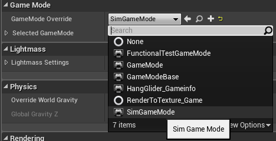

# Getting Started with the Fab Plugin

This page is for users who installed Cosys-AirSim from [Fab](https://www.fab.com/). It takes you from installing the plugin to flying a drone with a Python script in your own Unreal Engine project, in about 15 minutes. The rest of this documentation describes every feature in detail; links are given at the end of each step.

## What is Cosys-AirSim?

Cosys-AirSim is a simulator for drones, cars, skid-steer robots and computer vision research, built as an Unreal Engine plugin. You place it in any Unreal level, press Play, and a simulated vehicle with sensors appears that you can control and read out from your own code (Python, C++, MATLAB or ROS2) over a network API. It is used for:

- generating synthetic datasets: RGB, depth, surface normals, instance segmentation and custom annotation masks, LiDAR point clouds with labels
- testing perception, navigation and control algorithms before deploying them on real robots
- software-in-the-loop and hardware-in-the-loop testing with the PX4 and ArduPilot flight controllers
- reinforcement learning, with the simulator as environment

It is the Cosys-Lab (University of Antwerp) fork of Microsoft AirSim, extended with GPU LiDAR, a multi-layer annotation system, pulse echo (sonar/radar) sensors, skid-steer vehicles, artificial lights and more.

## What is in the plugin?

| Folder in `/AirSim/CosysAirSim` (Content Browser: tick *Show Plugin Content* in the settings, then **Plugins > AirSim Content > CosysAirSim**) | Contents |
|---|---|
| `Blueprints/Vehicles` | The vehicles that are spawned by the simulator: quadrotor (`BP_FlyingPawn`), SUV car (`BP_SuvCarPawn`), small indoor car (`BP_BoxCarPawn`), Clearpath Husky and Pioneer P3DX skid-steer robots (`BP_CPHuskyPawn`, `BP_PioneerPawn`) and a free-flying computer vision camera (`BP_ComputerVisionPawn`) |
| `Blueprints/Camera`, `Blueprints/Sensors` | The camera and sensor actors the vehicles use |
| `Blueprints/Weather` | Weather effects (rain, snow, fog, dust, leaves) and the in-game weather menu |
| `Blueprints/Lights` | Point and spot lights that can be spawned and controlled through the API |
| `Widgets` | The simulator HUD, loading screen and weather menu |
| `Materials`, `Meshes`, `Textures`, ... | Assets used by the vehicles, sensors, annotation and weather |

The simulation itself (vehicle physics, sensor models, the API server) is in the C++ code of the plugin. The simulator is configured with a `settings.json` file, not with Blueprints, so you normally do not need to place any of these assets yourself: press Play and the simulator spawns the vehicles and sensors from the settings.

## Requirements

- Unreal Engine 5.8 on Windows 64-bit or Linux (see the supported platforms on the Fab page).
- The engine plugin **Chaos Vehicles** (ships with Unreal Engine, enabled automatically with Cosys-AirSim).
- To control the simulation from code: Python 3.8 or newer (or C++, MATLAB or ROS2, see [Next steps](#next-steps)).
- A dedicated GPU is recommended, especially for cameras and GPU LiDAR.

## Step 1: Install the plugin

1. In the Epic Games Launcher, open **Fab Library**, find **Cosys-AirSim** and click **Install to Engine**. Choose Unreal Engine 5.8.
2. Open your project, or create a new one (any template works, Blueprint or C++, for example the *Blank* or *Third Person* template).
3. Open **Edit > Plugins**, search for **Cosys-AirSim**, tick **Enabled** and restart the editor when asked. Chaos Vehicles is enabled with it.

!!! note
    On Linux there is no Epic Games Launcher. Download the plugin from your Fab library in the browser, or use the precompiled plugin from the [GitHub releases](https://github.com/Cosys-Lab/Cosys-AirSim/releases) or [build it from source](install_linux.md), and place the `AirSim` plugin folder in the `Plugins` folder of your project.

## Step 2: Set up your level

1. Open the level you want to use. It needs a floor and a **Player Start** actor: the simulator spawns the vehicle at the Player Start. If your level has none, add one with **Quickly add to the project (the + button) > Basic > Player Start** and place it just above the floor.
2. Open **Window > World Settings** and set **GameMode Override** to **AirSimGameMode**.

    

3. Open **Edit > Editor Preferences**, search for `CPU` and untick **Use Less CPU when in Background**. Otherwise the simulation slows down as soon as the editor window loses focus, for example when you click on your Python terminal.
4. Save the level.

## Step 3: Create a settings file

Cosys-AirSim reads its configuration from `settings.json` in the `AirSim` folder of your documents folder:

- Windows: `C:\Users\<you>\Documents\AirSim\settings.json`
- Linux: `~/Documents/AirSim/settings.json`

The file is created empty the first time you press Play. Without a `SimMode`, the simulator asks every time which vehicle to use. To start with a drone, put this in the file:

```json
{
  "SettingsVersion": 2.0,
  "SimMode": "Multirotor"
}
```

Use `"Car"` for the SUV, `"SkidVehicle"` for the Husky robot or `"ComputerVision"` for a free camera without physics. The [settings documentation](settings.md) describes all options, such as adding vehicles, cameras, LiDARs and other sensors, and [settings_example.json](settings_example.json) is a complete example.

## Step 4: Press Play

Press **Play** in the editor. The drone appears at the Player Start and the HUD shows the camera view. Useful keys while playing:

| Key | Action |
|---|---|
| `F1` | Show all keys |
| `F`, `B`, `\`, `/`, `M`, `I`, `K` | Camera views: first person, fly with, ground, chase, manual, front, backup |
| `1`, `2`, `3`, `0` | Show the depth, segmentation and scene sub-windows, or all of them |
| `R` | Start or stop recording images and poses to `Documents/AirSim` |
| `F10` | Weather menu |
| `T` | Draw the vehicle trajectory |
| `;` | Debug report |
| `Backspace` | Reset the vehicles |

The drone does not fly on its own: you control it through the API (next step), or with a remote control or game pad (see [Remote Control](remote_control.md)).

## Step 5: Control the drone from Python

While the simulator is playing, it runs an API server on port 41451. Install the Python client:

```shell
pip install cosysairsim
```

Save this as `hello_drone.py` and run it with `python hello_drone.py` while the editor is in Play mode:

```python
import cosysairsim as airsim

client = airsim.MultirotorClient()
client.confirmConnection()
client.enableApiControl(True)
client.armDisarm(True)

# take off and fly to 10 m north, 5 m east, 5 m above the start (z points down)
client.takeoffAsync().join()
client.moveToPositionAsync(10, 5, -5, 3).join()

# save an image of the front camera
png = client.simGetImage("front_center", airsim.ImageType.Scene)
airsim.write_file("front_center.png", png)

# read a sensor
print(client.getImuData())

client.landAsync().join()
client.armDisarm(False)
client.enableApiControl(False)
```

All positions are in meters in the NED frame (x north, y east, z down) with the Player Start as origin. The [API documentation](apis.md) lists all functions, and the [Python examples on GitHub](https://github.com/Cosys-Lab/Cosys-AirSim/tree/main/PythonClient) cover cars, LiDAR, segmentation, annotation, weather and more.

## Step 6 (optional): Package your project

To package a project that uses Cosys-AirSim, make sure all plugin content is cooked, as the simulator loads most of it at runtime. Add this to `Config/DefaultGame.ini` of your project:

```ini
[/Script/UnrealEd.ProjectPackagingSettings]
+DirectoriesToAlwaysCook=(Path="/AirSim/CosysAirSim")
```

The packaged game reads the same `settings.json` and serves the same API. See [Download and run](run_packaged.md) for the command line options of a packaged build.

## Next steps

- [Settings](settings.md): vehicles, sensors, cameras, clock speed, multiple vehicles
- [Image APIs](image_apis.md): all camera image types, segmentation and annotation images
- [Sensors](sensors.md), [LiDAR](lidar.md), [GPU LiDAR](gpulidar.md), [Pulse Echo](echo.md): sensor configuration and data
- [Instance segmentation](instance_segmentation.md) and [Annotation](annotation.md): ground truth for machine learning
- [Car mode](using_car.md) and [Skid steer vehicles](skid_steer_vehicle.md)
- [ROS2](ros2.md), [MATLAB](matlab.md) and [C++ APIs](apis_cpp.md)
- [PX4](px4_setup.md): use a real flight controller stack

## FAQ

#### The plugin does not show up in Edit > Plugins.
Check that it was installed for the same engine version as your project (5.8): in the Epic Games Launcher, **Fab Library > Cosys-AirSim > Install to Engine**. Installed engine plugins are listed under **Installed > Science**.

#### I press Play but no vehicle appears, or the normal player pawn spawns.
The **GameMode Override** in **World Settings** is not set to **AirSimGameMode**, or the level has no **Player Start**. Both are set per level, so check them again when you open another level.

#### The vehicle spawns inside the floor, or falls from the sky.
The vehicle is placed at the **Player Start**. Move it to just above the floor.

#### A dialog asks "Would you like to use car/skid-vehicle simulation?" every time I press Play.
Set `SimMode` in `settings.json` (see [Step 3](#step-3-create-a-settings-file)).

#### My Python script cannot connect (it keeps printing dots or times out).
- The simulator only serves the API while the editor is in Play mode.
- The default port is 41451; check that no firewall blocks it when the script runs on another computer, and pass the IP address: `airsim.MultirotorClient(ip="<simulator IP>")`.
- Use the client for your SimMode: `MultirotorClient` for drones, `CarClient` for cars and skid-steer vehicles, `VehicleClient` for the rest.

#### The simulation becomes very slow when I click on another window.
Untick **Use Less CPU when in Background** in **Edit > Editor Preferences** (see [Step 2](#step-2-set-up-your-level)).

#### Camera images look wrong or miss effects since Unreal Engine 5.3.
Unreal Engine 5.3 and newer break scene captures unless the Effects scalability is set to Epic. Run the console command `r.DetailMode 2`, or add a `Config/DefaultScalability.ini` to your project with `r.DetailMode=2` for every Effects quality level. See [Unreal scene camera bug](unreal_custenv.md#unreal-scene-camera-bug).

#### Where are the recorded images saved?
In `Documents/AirSim/<date and time>/`. See [Modifying recording data](modify_recording_data.md) to change what is recorded.

#### Does it work in a Blueprint-only project?
Yes. The Fab version is compiled by Epic for your engine, so no C++ setup or Visual Studio is needed. Only adding your own C++ code to the simulator requires a C++ project.

#### Can I use my own vehicle model?
Yes. Create a Blueprint that inherits from the Cosys-AirSim pawn of the same type (for example a child of `BP_FlyingPawn` or `BP_SuvCarPawn`), and point the simulator to it with `PawnPaths` in `settings.json`. See [Settings](settings.md#pawnpaths) and [Skid steer vehicles](skid_steer_vehicle.md).

#### Can I connect PX4 or ArduPilot?
Yes, for software-in-the-loop and hardware-in-the-loop simulation. See [PX4 Setup](px4_setup.md) and [PX4 in SITL](px4_sitl.md).

#### Is there a ROS2 interface?
Yes, a ROS2 node publishes all sensors, cameras and the vehicle state, and accepts commands. It is not part of the Fab plugin: build it from the `ros2` branch of the GitHub repository, see [ROS2](ros2.md).

#### Which platforms are supported?
Windows 64-bit and Linux with Unreal Engine 5.8. Older engine versions are available from the [GitHub repository](https://github.com/Cosys-Lab/Cosys-AirSim) (5.2.1 is maintained as long term support version).

#### Where do I get help or report a bug?
Open an issue on [GitHub](https://github.com/Cosys-Lab/Cosys-AirSim/issues). Please include your Unreal Engine version, operating system, `settings.json` and the relevant part of the log (`Saved/Logs/<project>.log`).
